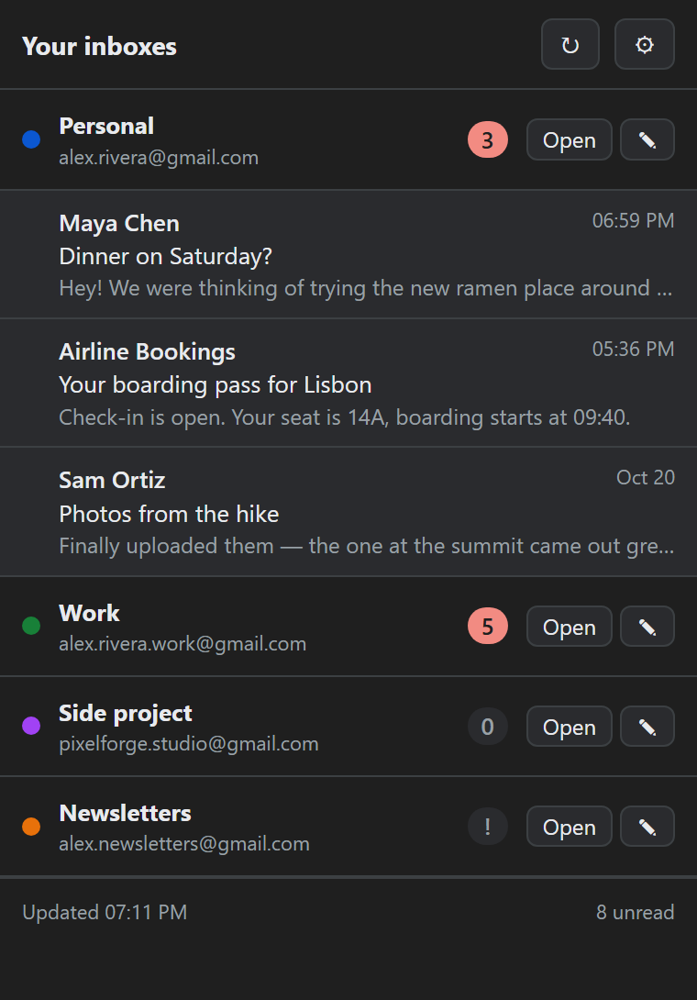
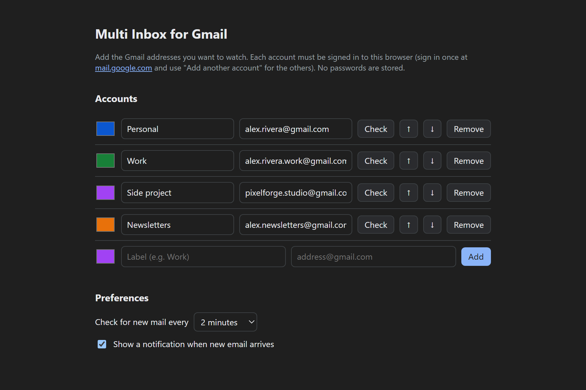
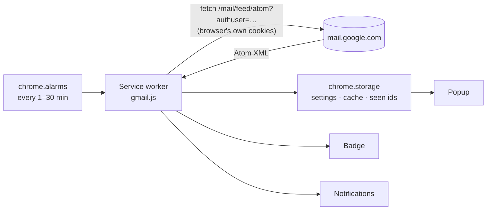

<p align="center">
  
</p>

<h1 align="center">Multi Inbox for Gmail</h1>

<p align="center">
  A lightweight browser extension that shows unread mail from <b>all your Gmail accounts</b> in one popup.<br>
  No passwords. No servers. No OAuth setup. Zero dependencies.
</p>

<p align="center">
  <a href="https://kernelpanikk.github.io/multi-inbox-for-gmail/docs/"><b>Live demo &amp; overview</b></a> ·
  <a href="#install">Install</a> ·
  <a href="#how-it-works">How it works</a> ·
  <a href="PRIVACY.md">Privacy</a>
</p>

<p align="center">
  
</p>

---

## The problem

Gmail shows one account at a time. If you have a personal address, a work address and one for a side project,
mail in the accounts you're not looking at goes unnoticed until you switch to them.

## The solution

Multi Inbox sits in the browser toolbar and keeps an eye on every account at once:

- **Every inbox at a glance** — one list with each account's label, color and unread count.
  Expand an account to see sender, subject and preview of its latest unread messages.
- **Combined badge** — the toolbar icon shows the total unread count, or `!` if an account needs you to sign in again.
- **Desktop notifications** — one per new message, or a grouped one per account. Click to jump straight to the conversation.
- **Opens the right account** — "Open", "Compose" and every message link land in the correct account,
  not whichever one Gmail treats as the default.
- **Simple settings** — add addresses, label and color them, reorder them, and check each connection with one click.
  Settings sync across your browsers through `chrome.storage.sync`.

<p align="center">
  
</p>

## Try it without installing

The [project page](https://kernelpanikk.github.io/multi-inbox-for-gmail/docs/) runs the **unmodified extension code** in the browser on sample data:
[`docs/demo/mock-chrome.js`](docs/demo/mock-chrome.js) stands in for the `chrome.*` APIs and answers Gmail feed
requests with fake XML, so the real parser, renderer and settings logic are what you're clicking on.

## Install

Works in Brave, Chrome, Edge and other Chromium-based browsers.

1. Download or clone this repository.
2. Open `brave://extensions` (or `chrome://extensions`, `edge://extensions`).
3. Turn on **Developer mode**.
4. Click **Load unpacked** and select the [`extension`](extension) folder.
5. The settings page opens: click **Add account** and sign in with Google in the tab that opens.
   The account is added automatically; repeat for each one.

## How it works

The usual way to read Gmail from an app is the Gmail API, which needs an OAuth client, a Google Cloud project and,
for a public extension that reads mail, Google's restricted-scope security assessment. This extension avoids all of
that by reading Gmail's built-in **Atom feed** with the sessions the browser already has.



1. **An alarm wakes the service worker.** Manifest V3 service workers don't stay alive, so polling is driven by `chrome.alarms`.
2. **One request per account, in parallel**, to `https://mail.google.com/mail/feed/atom?authuser=<address>`.
   The `mail.google.com` host permission lets the browser attach the user's existing Google cookies.
3. **The response is verified.** If an address isn't signed in, Google can silently answer for a *different* account,
   so the feed title is checked against the expected address before the data is trusted.
4. **XML is parsed without a DOM.** Service workers have no `DOMParser`, so the small, stable feed format is parsed
   with targeted regular expressions and entity decoding.
5. **New mail is detected by diffing** message ids against the previous check. An account's first check never notifies,
   so adding an account doesn't produce a burst of notifications.
6. **Badge, notifications and cache are updated.** The popup renders the cached result instantly and refreshes in the background.

### Project structure

```
extension/
├── manifest.json     Manifest V3: permissions, service worker, popup, options page
├── gmail.js          Shared logic: feed fetching and parsing, badge, notifications
├── background.js     Service worker: scheduling, startup, notification clicks
├── popup.html/.js    Toolbar popup
├── options.html/.js  Settings page
├── style.css         Shared styles, light and dark theme
└── icons/
docs/
├── index.html        Project page (GitHub Pages)
├── demo/             The real extension running on mocked browser APIs
└── screenshots/
```

About 600 lines of plain JavaScript, HTML and CSS: no framework, no bundler, no `node_modules`.

## Permissions

| Permission | Why |
| --- | --- |
| `https://mail.google.com/*` | Read the unread-mail feed of the accounts you add, using your existing browser session. |
| `storage` | Save your accounts and preferences; cache the last result so the popup opens instantly. |
| `alarms` | Check for new mail periodically in the background. |
| `notifications` | Tell you when new mail arrives (can be turned off). |

Mail data never leaves your browser. See the [privacy policy](PRIVACY.md).

## Limitations

- **Read-only.** Marking as read, archiving and replying happen in Gmail itself.
- **Up to 20 messages per account**, the most recent unread ones in the inbox — a limit of Gmail's feed.
- **Undocumented endpoint.** The Atom feed has been around for many years, but Google doesn't formally document it.
  If it ever went away, the Gmail API would be the replacement.

## Ideas for the future

- Gmail API mode (optional) for marking as read and archiving from the popup
- Per-account label filters (e.g. only `Important`)
- Keyboard navigation in the popup
- Localization

## License

[MIT](LICENSE) © kernelpanikk

*Not affiliated with or endorsed by Google. Gmail is a trademark of Google LLC.*
